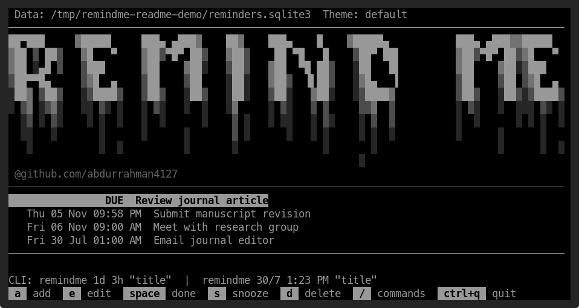

# !RemindMe

This is a simple pet project of mine to help me remember things and manage
reminders from the terminal. I'm putting it on GitHub so I don't forget about
it or lose it when I mess up my system.

!RemindMe is a local-first terminal reminder app for Linux and Windows, with
SQLite storage and optional desktop notifications.

## Preview

Screenshot of the running terminal UI:



### ASCII banner

The app loads this banner from [`assets/banner.txt`](assets/banner.txt), so
you can change the art without editing the Python code:

```text
██▀███     ▓█████     ███▄ ▄███▓    ██▓    ███▄    █    ▓█████▄           ███▄ ▄███▓▓█████
▓██ ▒ ██▒   ▓█   ▀    ▓██▒▀█▀ ██▒   ▓██▒    ██ ▀█   █    ▒██▀ ██▌         ▓██▒▀█▀ ██▒▓█   ▀
▓██ ░▄█ ▒   ▒███      ▓██    ▓██░   ▒██▒   ▓██  ▀█ ██▒   ░██   █▌         ▓██    ▓██░▒███
▒██▀▀█▄     ▒▓█  ▄    ▒██    ▒██    ░██░   ▓██▒  ▐▌██▒   ░▓█▄   ▌         ▒██    ▒██ ▒▓█  ▄
░██▓ ▒██▒   ░▒████▒   ▒██▒   ░██▒   ░██░   ▒██░   ▓██░   ░▒████▓          ▒██▒   ░██▒░▒████▒
░ ▒▓ ░▒▓░   ░░ ▒░ ░   ░ ▒░   ░  ░   ░▓     ░ ▒░   ▒ ▒     ▒▒▓  ▒          ░ ▒░   ░  ░░░ ▒░ ░
  ░▒ ░ ▒░    ░ ░  ░   ░  ░      ░    ▒ ░   ░ ░░   ░ ▒░    ░ ▒  ▒          ░  ░      ░ ░ ░  ░
  ░░   ░       ░      ░      ░       ▒ ░      ░   ░ ░     ░ ░  ░          ░      ░      ░
   ░           ░  ░          ░       ░              ░       ░                    ░      ░  ░
                                                          ░
```

## Directory contents

| Path | Purpose |
| --- | --- |
| `remindme.py` | Application: TUI, command-line parser, SQLite storage, and notification loop. |
| `remindme`, `!remindme`, `!remind` | Executable command entry points. |
| `remindme.service` | systemd user unit for background desktop notifications. |
| `PKGBUILD` | Arch Linux package recipe for installing directly from a clone. |
| `packaging/` | Debian package builder and packaged systemd user unit. |
| `test_remindme.py` | Automated tests for date parsing and notification behavior. |
| `assets/banner.txt` | Editable UTF-8 ASCII/Unicode art displayed in the TUI header. |
| `assets/figs/reminders.png` | Screenshot example of the !RemindMe terminal UI. |
| `.gitignore` | Keeps Python bytecode and local database artifacts out of Git. |

## Requirements

- Python 3.10 or later for running from source.
- A terminal with curses support. Windows source installs need the
  `windows-curses` package.
- On Linux, systemd user services and `notify-send` provide optional
  background desktop alerts.
- On Windows, `winotify` provides optional Windows toast notifications.

The downloadable Windows executable includes its runtime and dependencies.

## Install a release

### Debian and Ubuntu

Download `remindme_1.0.1_all.deb` from the
[latest GitHub release](https://github.com/abdurrahman4127/RemindMe/releases/latest),
then install it with apt:

```sh
sudo apt install ./remindme_1.0.1_all.deb
```

The package installs `remindme`, `remind`, `!remindme`, and `!remind` in
`/usr/bin`. Enable background notifications with
`systemctl --user enable --now remindme.service`.

### Arch Linux and derivatives

Clone the repository and build/install the package with `makepkg`:

```sh
sudo pacman -S --needed base-devel git
git clone https://github.com/abdurrahman4127/RemindMe.git
cd RemindMe
makepkg -si
```

The repository includes the `PKGBUILD`; no AUR account or separate source
download is needed. The installed command names and optional user service are
the same as for the Debian package.

### Windows

Download `!remindme.exe`, `!remind.exe`, or `remindme.exe` from the
[latest GitHub release](https://github.com/abdurrahman4127/RemindMe/releases/latest).
Run the executable in PowerShell:

```powershell
& ".\!remindme.exe"
& ".\!remind.exe" in 20m "Email the journal editor"
& ".\remindme.exe" --help
```

The executable is self-contained. To run from a source checkout instead,
install Python 3.10 or later and run:

```powershell
git clone https://github.com/abdurrahman4127/RemindMe.git
cd RemindMe
py -m pip install -r requirements-windows.txt
py remindme.py
```

To run the Windows notification loop, start `!remindme.exe --daemon`. Keep the
process running or configure it to start at login in Windows Task Scheduler.

### Run from a Linux source checkout

From a terminal, create `~/.local/bin` if needed and link the tracked entry
points there:

```sh
mkdir -p "$HOME/.local/bin"
ln -sfn "$HOME/scripts/RemindMe/remindme" "$HOME/.local/bin/remindme"
ln -sfn "$HOME/scripts/RemindMe/"'!remindme' "$HOME/.local/bin/"'!remindme'
ln -sfn "$HOME/scripts/RemindMe/"'!remind' "$HOME/.local/bin/"'!remind'
```

Ensure `~/.local/bin` is on `PATH`. For Bash, add this to `~/.bashrc` if it is
not already present, then open a new terminal:

```sh
export PATH="$HOME/.local/bin:$PATH"
```

The `remind` command is retained as a compatibility alias. To recreate it:

```sh
ln -sfn "$HOME/scripts/RemindMe/remindme" "$HOME/.local/bin/remind"
```

## Use

Run `!remindme` or `!remind` with no arguments to open the TUI in the current
terminal. Both are also available as `remindme` and `remind`.
In Bash or Zsh, escape the leading exclamation mark when invoking the bang
commands (for example, `\!remindme`).

Run it with a due-time phrase to create a reminder directly without opening
the TUI. The existing positional syntax remains supported:

```sh
!remindme in 20m "Email the journal editor"
!remind in 2h "Send an update to the research group"
!remindme 1d 3h "Review the literature review"
!remind 3d 47m "Submit the revised manuscript"
!remindme 8pm "Email the coauthor"
!remind 8 pm "Review the paper"
!remindme today 8pm "Send the project update"
!remind today 8 pm "Review the paper"
!remindme 8:07pm "Check the submission portal"
!remind tomorrow 12am "Submit the conference abstract"
!remindme tomorrow 12pm "Meet with the research group"
!remind tomorrow 20:30 "Prepare conference slides"
!remindme 30/07 1am "Submit the grant application"
!remind 30/7 1am "Proofread the revised manuscript"
!remindme 25 nov, 1am "Prepare the LinkedIn post"
!remind 16 dec, 11am "Prepare the LinkedIn post"
!remindme 2/6, 1:23 PM "Email the journal editor"
!remind on 2/6 at 1:23 PM "Meet with the research group"
!remindme tomorrow 9:00 AM "Finish the peer review"
!remind today 1:23 PM "Send the revision update"
```

You can also use `-t`/`--time` for the due time and `-n`/`--note` for the
reminder title. Quote multiword values; the flags can appear in either order.
The title is optional and defaults to `Reminder`:

```sh
!remindme -t "in 2h" -n "Email the journal editor"
!remindme -n "Review the paper" -t "tomorrow 9am"
!remindme --time "25 nov, 1am" --note "Prepare the LinkedIn post"
!remindme -t "in 20m"
```

Do not combine the flag form with positional reminder arguments.

Relative time accepts combined days (`d`), hours (`h`), and minutes (`m`), for
example `1d 3h` means 27 hours from now and `3d 47m` means 3 days and 47
minutes from now. You can optionally prefix these with `in`. For clock times,
use either 24-hour time or 12-hour time with `AM`/`PM`. A date is optional for
12-hour times: `8pm`, `8 pm`, and `today 8pm` all mean today at 8:00 PM;
`8:07pm` means 8:07 PM. If minutes are omitted, they default to `00`.
`12am` is midnight and `12pm` is noon. Calendar dates use day/month without a
year; both `30/07` and `30/7` are valid. English month names and abbreviations
are also accepted, as in `25 nov, 1am` or `25 November, 1am`. A date can be
followed by a time such as `30/7 1am` or `2/6, 1:23 PM`; it resolves to the
next future occurrence in the local timezone. Reminder times in the TUI use
12-hour format with an `AM` or `PM` suffix. Existing 24-hour clock inputs such
as `20:00` remain supported, including with a day/month date. Calendar dates
do not accept a year. If no title follows the time, the title is `Reminder`.

A bare hour such as `8` is interpreted using the current local time. For
example, before 8:00 AM it means 8:00 AM today. After 8:00 AM, !RemindMe asks
you to confirm 8:00 PM today or enter a different time. If both occurrences
have passed, it asks whether you meant 8:00 AM or 8:00 PM tomorrow. If an
explicitly specified today time has already passed (for example, `today 8pm`
after 8:00 PM), !RemindMe asks whether to keep it today or move it to tomorrow.

Put reminder titles in quotes to preserve spaces, for example,
`!remindme 8pm "Review the paper"` or
`!remind 30/07 1am "Submit the grant application"`.

TUI keys:

| Key | Action |
| --- | --- |
| `↑`/`↓` or `j`/`k` | Select a reminder |
| `a` | Add a reminder interactively |
| `e` | Edit the selected reminder |
| `space` | Mark done or reopen |
| `s` | Snooze for 10 minutes |
| `d` | Delete after confirmation |
| `ctrl+q` | Quit |
| `/` | Open the bottom-docked searchable command palette |

In the bottom command area, type to filter the suggestions shown above it,
use Up/Down to select, Tab to complete the highlighted suggestion, Enter to
run a command, and Escape to close it. Escape cancels the active prompt or
closes the palette; press Ctrl+Q to quit the app. Select `theme` to open the
theme picker; theme names are kept out of the main command suggestions and
shown only in that picker. The palette commands are `add`, `edit`, `done`,
`snooze`, `delete`, `theme`, `help`, and `quit`.

The theme picker starts on the currently active theme. Moving the selection
previews each theme immediately. Press Enter to save the preview as the new
theme, or Escape to restore the previous theme. Theme selection is saved
between runs.

When entering or editing text, Left/Right move the insertion cursor, Home/End
move to the beginning/end, Backspace deletes before the cursor, and Delete
deletes after it. Enter submits the field; Escape cancels the current input.

The TUI header includes command examples and the key guide at the bottom of
the screen.

The bottom key guide puts a shaded background behind each key and the single
space on either side of it. Action labels are plain text, with no colon
separator; for example, the guide appears as ` a ` add  ` e ` edit. The
palette’s own footer similarly highlights only its key labels.

Use `!remindme --help` or `!remind --help` for command-line options. Pass
`--database PATH` before or after the reminder phrase to use a different
SQLite database.

## Customize

The app is intentionally small. Personalize it without changing Python code:

1. Open `assets/banner.txt` in a text editor.
2. Select all of its contents and replace them with your own banner, one
   visual row per text line. Keep leading spaces if your art uses indentation,
   and save the file as UTF-8.
3. Run `!remindme` again to see the new banner. The app reads the file each
   time it starts the TUI.

The tagline below the art is separate. To change it, edit the
`@github.com/abdurrahman4127` string in `draw()` in `remindme.py`.

Other useful settings in `remindme.py`:

- `POLL_SECONDS`: how often the background service checks for due reminders.
- `SNOOZE_MINUTES`: the TUI snooze duration.
- `NOTIFICATION_TIMEOUT_MS`: requested desktop-alert duration. The desktop
  notification daemon may override it.
- Use `/theme` to browse 24 themes, including Slate Blue, GitHub, Catppuccin,
  Dracula, Nord, Gruvbox, Tokyo Night, Solarized, and more. The original plain
  terminal appearance is preserved by the `default` theme.
  Your choice is saved in
  `$XDG_CONFIG_HOME/remindme/config.json` (or `~/.config/remindme/config.json`)
  on Linux, and `%APPDATA%\RemindMe\config.json` on Windows.
  To add or recolor themes, edit the hex color tuples in `THEMES` in
  `remindme.py`.


- Available themes: `default`, `slate-blue`, `github-dark`, `github-light`,
  `catppuccin-mocha`, `catppuccin-latte`, `dracula`, `nord`, `gruvbox-dark`,
  `gruvbox-light`, `tokyo-night`, `one-dark`, `monokai`, `solarized-dark`,
  `solarized-light`, `rose-pine`, `kanagawa`, `everforest`, `matrix`,
  `synthwave`, `ocean`, `forest`, `ember`, and `high-contrast`.

Set `XDG_DATA_HOME` to move the default database location, or pass
`--database PATH` when running the command.

For a source checkout, if you install the project somewhere other than
`~/scripts/RemindMe`, update `ExecStart` in `remindme.service`, then
relink/restart the user service:

```sh
systemctl --user disable --now remindme.service
systemctl --user link "$HOME/scripts/RemindMe/remindme.service"
systemctl --user daemon-reload
systemctl --user enable --now remindme.service
```

## Enable desktop notifications

The systemd user service checks every 10 seconds. When the computer is asleep
or powered off, it cannot display an alert; once the user service runs again,
it catches up and sends reminders that are still pending. The service runs
after the user session starts. Desktop notifications generally require logging
into the graphical session.

Enable the service for this checkout:

```sh
systemctl --user link "$HOME/scripts/RemindMe/remindme.service"
systemctl --user daemon-reload
systemctl --user enable --now remindme.service
```

On Debian/Ubuntu and Arch packages, the service unit is installed system-wide
for user sessions; enable it with:

```sh
systemctl --user enable --now remindme.service
```

Check service health and recent logs:

```sh
systemctl --user status remindme.service --no-pager
journalctl --user -u remindme.service -n 50 --no-pager
```

On Linux, notifications request a 30-second timeout via `notify-send
--expire-time=30000`. Some desktop environments ignore applications' timeout
requests and use their own notification settings. Windows uses native toast
notifications through `winotify`.

To disable the service without deleting its unit file:

```sh
systemctl --user disable --now remindme.service
```

## Data and backup

By default, reminders are stored outside this Git repository at
`$XDG_DATA_HOME/remindme/reminders.sqlite3`, or
`~/.local/share/remindme/reminders.sqlite3` if `XDG_DATA_HOME` is unset.
On Windows, the database is stored at
`%LOCALAPPDATA%\RemindMe\reminders.sqlite3`.
The CLI and notification service use the same database. `--database PATH`
overrides the location for a CLI invocation; the background service continues
using its default database.

Back up the SQLite database to preserve reminders. For example, stop the
service, copy the database, and start the service again:

```sh
systemctl --user stop remindme.service
cp "$HOME/.local/share/remindme/reminders.sqlite3" "$HOME/reminders.sqlite3.backup"
systemctl --user start remindme.service
```

If `XDG_DATA_HOME` is set, substitute that directory for `~/.local/share`.

## Development and tests

Run the test suite from this directory (Windows source tests require the
packages in `requirements-windows.txt`):

```sh
python -m unittest -v
```

The tests use temporary databases and do not send real desktop notifications.
