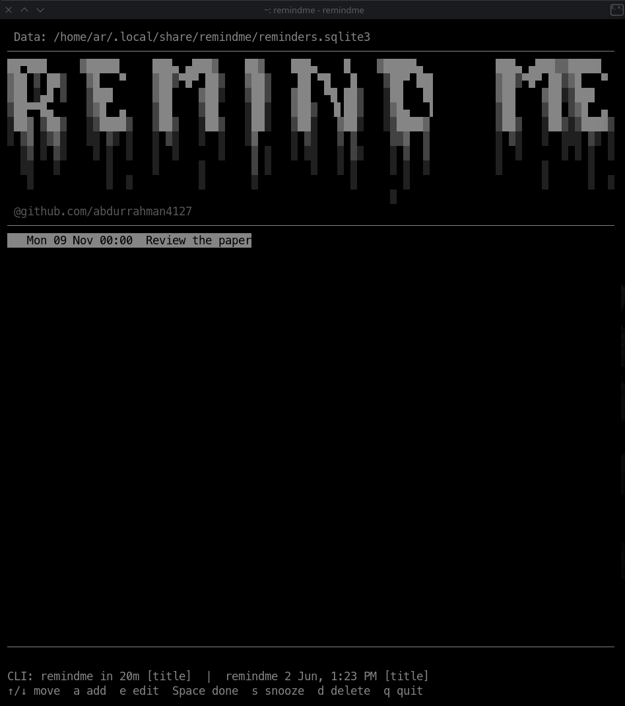

# RemindMe

This is a simple pet project of mine to help me remember things and manage
reminders from the terminal. I'm putting it on GitHub so I don't forget about
it or lose it when I mess up my system.

RemindMe is a local-first Linux reminder app with a terminal UI, SQLite
storage, and optional desktop notifications.

## Preview

Here is an example of the app running in a terminal:



### ASCII banner

The app loads this banner from [`assets/banner.txt`](assets/banner.txt), so
you can change the art without editing the Python code:

```text
██▀███     ▓█████     ███▄ ▄███▓    ██▓    ███▄    █    ▓█████▄           ███▄ ▄███▓▓█████
▓██ ▒ ██▒   ▓█   ▀    ▓██▒▀█▀ ██▒   ▓██▒    ██ ▀█   █    ▒██▀ ██▌         ▓██▒▀█▀ ██▒▓█   ▀
▓██ ░▄█ ▒   ▒███      ▓██    ▓██░   ▒██▒   ▓██  ▀█ ██▒   ░██   █▌         ▓██    ▓██░▒███
▒██▀▀█▄     ▒▓█  ▄    ▒██    ▒██    ░██░   ▓██▒  ▐▌██▒   ░▓█▄   ▌         ▒██    ▒██ ▒▓█  ▄
░██▓ ▒██▒   ░▒████▒   ▒██▒   ░██▒   ░██░   ▒██░   ▓██░   ░▒████▓          ▒██▒   ░██▒░▒████▒
░ ▒▓ ░▒▓░   ░░ ▒░ ░   ░ ▒░   ░  ░   ░▓     ░ ▒░   ▒ ▒     ▒▒▓  ▒          ░ ▒░   ░  ░░░ ▒░ ░
  ░▒ ░ ▒░    ░ ░  ░   ░  ░      ░    ▒ ░   ░ ░░   ░ ▒░    ░ ▒  ▒          ░  ░      ░ ░ ░  ░
  ░░   ░       ░      ░      ░       ▒ ░      ░   ░ ░     ░ ░  ░          ░      ░      ░
   ░           ░  ░          ░       ░              ░       ░                    ░      ░  ░
                                                          ░
```

## Directory contents

| Path | Purpose |
| --- | --- |
| `remindme.py` | Application: TUI, command-line parser, SQLite storage, and notification loop. |
| `remindme` | Small executable entry point used by the shell command. |
| `remindme.service` | systemd user unit for background desktop notifications. |
| `test_remindme.py` | Automated tests for date parsing and notification behavior. |
| `assets/banner.txt` | Editable UTF-8 ASCII/Unicode art displayed in the TUI header. |
| `assets/demo.png` | Screenshot example of the RemindMe terminal UI. |
| `.gitignore` | Keeps Python bytecode and local database artifacts out of Git. |

## Requirements

- Linux and Python 3.10 or later (uses only the Python standard library).
- A terminal with curses support for the TUI.
- systemd user services and `notify-send` for background desktop alerts.
- A graphical-session notification daemon. The notification daemon decides
  whether it honors the requested 30-second display timeout.

No Python dependencies are required. The app does not install packages.

## Install the shell command

From a terminal, create `~/.local/bin` if needed and link the tracked entry
point there:

```sh
mkdir -p "$HOME/.local/bin"
ln -sfn "$HOME/scritps/RemindMe/remindme" "$HOME/.local/bin/remindme"
```

Ensure `~/.local/bin` is on `PATH`. For Bash, add this to `~/.bashrc` if it is
not already present, then open a new terminal:

```sh
export PATH="$HOME/.local/bin:$PATH"
```

The `remind` command is retained as a compatibility alias. To recreate it:

```sh
ln -sfn "$HOME/scritps/RemindMe/remindme" "$HOME/.local/bin/remind"
```

## Use

Run `remindme` with no arguments to open the TUI in the current terminal.

Run it with a due-time phrase to create a reminder directly without opening
the TUI:

```sh
remindme in 20m Take medicine
remindme in 2h
remindme 2 Jun, 1:23 PM Call Sam
remindme on 2 June at 1:23 PM Call Sam
remindme tomorrow 09:00 Water plants
remindme 2026-11-02 14:30 Submit report
```

Relative time accepts minutes (`m`), hours (`h`), or days (`d`). Month/day
dates without a year resolve to the next future occurrence in the local
timezone. If no title follows the time, the title is `Reminder`.

TUI keys:

| Key | Action |
| --- | --- |
| Up/Down or `j`/`k` | Select a reminder |
| `a` | Add a reminder interactively |
| `e` | Edit the selected reminder |
| Space | Mark done or reopen |
| `s` | Snooze for 10 minutes |
| `d` | Delete after confirmation |
| `q` or Escape | Quit |

When entering or editing text, Left/Right move the insertion cursor, Home/End
move to the beginning/end, Backspace deletes before the cursor, and Delete
deletes after it. Enter submits the field; Escape cancels the current input.

The TUI header includes command examples and the key guide at the bottom of
the screen.

Use `remindme --help` for command-line options. Pass `--database PATH` before
or after the reminder phrase to use a different SQLite database.

## Customize

The app is intentionally small. Personalize it without changing Python code:

1. Open `assets/banner.txt` in a text editor.
2. Select all of its contents and replace them with your own banner, one
   visual row per text line. Keep leading spaces if your art uses indentation,
   and save the file as UTF-8.
3. Run `remindme` again to see the new banner. The app reads the file each
   time it starts the TUI.

The tagline below the art is separate. To change it, edit the
`@github.com/abdurrahman4127` string in `draw()` in `remindme.py`.

Other useful settings in `remindme.py`:

- `POLL_SECONDS`: how often the background service checks for due reminders.
- `SNOOZE_MINUTES`: the TUI snooze duration.
- `NOTIFICATION_TIMEOUT_MS`: requested desktop-alert duration. The desktop
  notification daemon may override it.

Set `XDG_DATA_HOME` to move the default database location, or pass
`--database PATH` when running the command.

If you install the project somewhere other than `~/scritps/RemindMe`, update
`ExecStart` in `remindme.service`, then relink/restart the user service:

```sh
systemctl --user disable --now remindme.service
systemctl --user link "$HOME/scritps/RemindMe/remindme.service"
systemctl --user daemon-reload
systemctl --user enable --now remindme.service
```

## Enable desktop notifications

The systemd user service checks every 10 seconds. When the computer is asleep
or powered off, it cannot display an alert; once the user service runs again,
it catches up and sends reminders that are still pending. The service runs
after the user session starts. Desktop notifications generally require logging
into the graphical session.

Enable the service for this checkout:

```sh
systemctl --user link "$HOME/scritps/RemindMe/remindme.service"
systemctl --user daemon-reload
systemctl --user enable --now remindme.service
```

Check service health and recent logs:

```sh
systemctl --user status remindme.service --no-pager
journalctl --user -u remindme.service -n 50 --no-pager
```

The notification requests a 30-second timeout via `notify-send
--expire-time=30000`. Some desktop environments ignore applications' timeout
requests and use their own notification settings.

To disable the service without deleting its unit file:

```sh
systemctl --user disable --now remindme.service
```

## Data and backup

By default, reminders are stored outside this Git repository at
`$XDG_DATA_HOME/remindme/reminders.sqlite3`, or
`~/.local/share/remindme/reminders.sqlite3` if `XDG_DATA_HOME` is unset.
The CLI and notification service use the same database. `--database PATH`
overrides the location for a CLI invocation; the background service continues
using its default database.

Back up the SQLite database to preserve reminders. For example, stop the
service, copy the database, and start the service again:

```sh
systemctl --user stop remindme.service
cp "$HOME/.local/share/remindme/reminders.sqlite3" "$HOME/reminders.sqlite3.backup"
systemctl --user start remindme.service
```

If `XDG_DATA_HOME` is set, substitute that directory for `~/.local/share`.

## Development and tests

Run the test suite from this directory:

```sh
python3 -m unittest -v
```

The tests use temporary databases and do not send real desktop notifications.

## Troubleshooting

- **`remindme: command not found`:** confirm `~/.local/bin` is on `PATH` and
  the link targets `~/scritps/RemindMe/remindme`.
- **No notification while the laptop was off/asleep:** alerts cannot run while
  the machine is unavailable. After login, check `systemctl --user status
  remindme.service`; pending due reminders are checked at service startup.
- **Service cannot start:** inspect `journalctl --user -u remindme.service`.
  The unit expects this repository at `~/scritps/RemindMe`.
- **No desktop alert:** check that `notify-send` is available and that the
  graphical session has a notification daemon. Failed notifications remain
  retryable and are logged by the service.
- **Alert vanishes before 30 seconds:** the application requests 30 seconds,
  but the desktop notification daemon may enforce a shorter duration.

If you wanna add something to it, go ahead.
